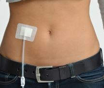

## Turinys

- [DUK apie peritoninę dializę](#PD)
  - [Kiek laiko egzistuoja PD gydymas?](#PD1)
  - [Kaip kūne atrodo kateteris?](#PD2)
  - [Kaip pasiruošti PD kateterio implantavimui? Kaip viskas vyks?](#PD3)
- [DUK apie transplantaciją](#Tr)
  - [Kas yra inkstų transplantacija? Kam ji atliekama?](#Tr1)
  - [Transplantacijos rūšys](#Tr2)
  - [Kas vyskta atsiradus donorui](#Tr3)
  - [Kaip vyksta inksto transplantacijos operacija?](#Tr4)
  - [Komplikacijos](#Tr5)
  - [Kas vyksta po inksto transplantacijos operacijos?](#Tr6)
  - [Stebėjimas po transplantacijos](#Tr7)

## DUK APIE PERITONINĘ DIALIZĘ {#PD}

### Kiek laiko egzistuoja PD gydymas? {#PD1}

Pirmą kartą eksperimentinis PD panaudojimas uremijos gydymui aprašytas Miunchene 1923 metais. 1959 metais jau modernią peritoninę dializę taikė Niujorko gydytojai Mortonas Maksvelas ir Homeras Smitas, o 1962-1964 metais Sietlo mokslininkų grupė ėmė taikyti PD programą galutinės stadijos inkstų ligos pacientų ilgalaikiam gydymui ir sukūrė PD aparatą. Lietuvoje PD pradėta taikyti 1994 metais.

### Kaip paciento kūne atrodo PD kateteris? {#PD2}

Kateterio vaizdas pilve. PD kateterio implantavimo vieta parenkama atsižvelgiant į žmogaus kūno ypatybes ir įpročius: anga turi būti pacientui matoma, negali slėptis paodžio riebalų klostėse, negali būti kelnių diržo lygyje.

### Kaip pasiruošti PD kateterio implantavimui? Kaip viskas vyks? {#PD3}

Peritoninei dializei atlikti implantuojamas nuolatinis peritoninės dializės kateteris. PD kateterio implantavimas prasideda nuo anamnezės ir paciento apžiūros kurios metu įvertinamos paciento galimybės atlikti PD, pilvo sienos randai, raukšlės, diržo linija ir pan. Numatomos operacinio pjūvio sritys, kateterio išėjimo angos vieta, kateterio kryptis. PD kateteriai implantuojami trimis būdais: punkciniu, atviros laparotomijos būdu, laparoskopiškai. Kuriuo būdu kateteris bus implantuotas, priklauso nuo procedūrą atliekančio specialisto pasirinkimo. Prieš operaciją pacientas turi nevalgyti ir negerti, skiriama antibiotikų profilaktika, mašinėle nukerpami plaukai operacinės žaizdos sirtyje, trombozių profilaktikai kojos bintuojamos elastiniais bintais arba naudojamos kompresinės kojinės. Pacientas turi būti tuščia šlapimo pūsle, gali būti klizmuojamas. Kateteris paprastai implantuojamas taikant bendrinę nejautrą. Kurioje kūno vietoje formuojama kateterio anga, priklauso nuo žmogaus kūno ypatybių ir įpročių: anga turi būti pacientui matoma, negali slėptis paodžio riebalų klostėse, negali būti kelnių diržo lygyje. Po kataterio implantavimo pacientas iš operacinės grįžta į palatą. Keltis, gerti ir valgyti gali praėjus 3-6 val. po operacijos. Pooperacinio skausmo malšinimui pakanka nesteroidinių priešuždegiminių vaistų. Kojos nubintuojamos (ar numaunamos kojinės) pacientui pradėjus vaikščioti. Prieš pradedant PD atliekama pilvo ir dubens apžvalginė rentgenograma. Po operacijos žaizda neperrišama 7-10 dienų. Tuo laikorapiu negalima šlapinti žaizdos! Po 7-10 dienų atliekamas perrišimas, pašalinami operaciniai siūlai.

## DUK APIE TRANSPLANTACIJĄ {#Tr}

### Kas yra inkstų transplantacija? Kam ji atliekama? {#Tr1}

Inkstų transplantacija (persodinimas) – chirurginė procedūra, kurios metu paimamas funkcionuojantis vieno žmogaus (donoro) inkstas ir persodinamas kitam žmogui (recipientui). Ši procedūra atliekama žmonėms su terminaliniu inkstų funkcijos nepakankamumu, kai savi inkstai nebesugeba atlikti savo funkcijų ir nepašalina iš organizmo skysčių ir kitų nereikalingų medžiagų. Inkstų transplantacija siekiama padaryti pacientą nepriklausomą nuo dializių, pagerinti žmogaus gyvenimo kokybę, socialiai jį adaptuoti ir būti lygiaverčiui su savo amžiaus grupės žmonėms.

### Inkstų transplantacijos rūšys {#Tr2}

Transplantacija galima iš gyvo (kai persodinamas sveikas donoro inkstas recipientui. Sveiką inkstą gali dovanoti giminystės ryšiu turintys žmonės) arba mirusio donoro (kai recipientui persodinamas funkcionuojantis inkstas žmogaus, kuriam buvo konstantuota galvos smegenų mirtis ir kurio artimieji pasirašė sutikimą donorystei).

### Kas vyskta atsiradus donorui {#Tr3}

Jei turite giminaitį, kuris Jums sutinka dovanoti inkstą, turite apie tai informuoti Jus gydantį nefrologą. Prieš transplantaciją donoras ir recipientas pilnai ambulatoriškai ištiriami. Atlikus visus būtinus imunologinius ir kitus tyrimus, jie hospitalizuojami planine tvarka į Urologijos skyrių ir ruošiami transplantacijos operacijai.

Jeigu Jūs laukiate mirusio donoro inksto, prieš patenkant į laukiančiųjų sąrašą Jums bus atliekami išsamūs Jūsų sveikatos tyrimai (reikės gauti pažymas, kad kontraindikacijų inksto transplantacijai nėra iš: odontologo, kardiologų ir t.t. Išsamią informaciją kokius tyrimus turite atlikti Jums pasakys Jus gydantis nefrologas.). Kai jau būsite įrašytas į mirusio inksto donoro laukiančiųjų sąrašą, Jūs visada turėsite būti pasiekiamas Jūsų nurodytu telefono numeriu. Atsiradus mirusiam donorui potencialūs recipientai kviečiami į Kauno Universitetinės ligoninės arba VU Santaros klinikas ir tiriami. Paprastai kviečiami 3 potencialūs recipientai vienam inkstui. Atliekami tyrimai pagal inkstų transplantacijos procedūrą. Gavus tyrimų rezultatus, konsiliumo metu parenkamas recipientas, kuriam bus planuojama atlikti inkstų transplantacijos operaciją. Gydytojas nefrologas, vadovaudamasis konsiliumo išvadomis, informuoja ligonį apie skiriamą priešoperacinį gydymą, preliminarų operacijos laiką, paskiria konsiliumo metu paskirtą imunosupresinį gydymą, reikalui esant skiria papildomus tyrimus.

### Kaip vyksta inksto transplantacijos operacija? {#Tr4}

Prieš operaciją pacientas turi visiškai nevalgyti ir negerti, išskyrus gydytojo anestezologo-reanimatologo paskirtus vaistus arba nuolat vartojamus vaistus, kurių vartojimas aptartas su gydytoju. Žarnyno paruošimui atliekamos valomosios klizmos. Jei reikalinga, išgeriami paskirti vaistai nerimo sumažinimui. Turi būti paruošta operacijos vieta (nuskutami plaukai, nusiprausiama duše). Prieš operaciją užmaunamos elastinės kojnės arba užbintuojami elastiniai vyturiai. Pasiruošus operacijai, pacientas keliamas į operacinę.

Operacinėje įvedamas kateteris į perifeninę ar centrinę veną. Operacijos metu taikoma bendrinė nejautra. Prieš operaciją į šlapimo pūslę įkišamas kateteris ir šlapimo pūslė pripildoma fiziologiniu skysčiu. Operacinis laukas dezinfekuojamas tam skirtais dezinfekciniais tirpalais. Kadangi donoro inkstas įsiuvamas ne tipinėje inkstų vietoje, o klubinėje srityje, todėl atliekamas įstrižinis operacinis pjūvis klubinėje srityje. Esant komplikuotam šlapimtakio ir šlapimo pūslės anastomozės suformavimui, šlapimtakyje paliekamas vamzdelis (šlapimtakio stentas). Po operacijos paliekami žaizdos audinių drenai. Operacijos trukmė vidutiniškai 2–3 valandos.

### Komplikacijos {#Tr5}

Pirmą pooperacinę parą apie 65 – 80% pacientų inkstų funkcija atsistato iš karto po atliktos operacijos. Kitais atvejais būna laikinas ūminis inksto nepakankamumas, tuomet inksto funkscija atsistato palaipsniui. Dažniausiai pasitaikančios komplikacijos:

- Kraujavimas. Dėl kraujavimo retais atvejais tenka pakartotinai operuoti, atlikti kraujavimo stabdymo procedūras.
- Infekcija. Pasitaiko dažniau, nes vartojami imunosupresiniai vaistai, kurie slopina imuninį atsaką į virusus ir bakterijas. Todėl didesnės rizikos grupės pacientams papildomai skiriama antivirusinė ir antibakterinė profilaktika.
- Ūminis inksto funkcijos nepakankamumas. Reikalingos pakaitinės hemodializės.
- Transplantuoto inksto atmetimas.
- Limfocelės (audinių skysčių susikaupimas) aplink transplantuotą inkstą atsiradimas, kuri gali spausti šlapimtakį.
- Žarnų nepraeinamumas.
- Komplikacijos susijusios su anestezija.
- Pooperacinė pilvo sienos išvarža.
- Lydinčių lėtinių ligų pablogėjimas

### Kas vyksta po inksto transplantacijos operacijos? {#Tr6}

Po operacijos pacientas vežamas į prabudimo palatą, kur jį prižiūri gydytojas anesteziologas-reanimatologas. Iš jos perkeliamas į reanimacijos ir intensyvios terapijos skyrių arba į Urologijos skyrių. Skyriuje pacientui kontroliuojami pagrindiniai kraujotakos rodikliai (kraujo spaudimas, pulsas), matuojamas šlapimo kiekis, drenažinių vamzdelių išskyrų kiekis ir vertinamas jų pobūdis, lašinami skysčiai į veną, skiriami medikamentai pagal reikalą. Skiriami nuskausminantys medikamentai, medikamentai venų trombozės profilaktikai. Pirmą parą po operacijos pacientas, aptaręs fizinio krūvio pobūdį ir apimtį su operavusiu gydytoju, gali pradėti vaikščioti. Šlapimo pūslės kateteris ištraukiamas po 1–3 parų (esant reikalui, jis laikomas ir ilgiau). Nuolat perrišama operacinė žaizda ir vertimas jos gijimas. Imunosupresija taikoma pagal anksčiau įvertintą recipiento gydymo riziką ir skiriamas gydymas pagal numatytus protokolus. Keičiantis klinikinei situacijai organizuojamas gydytojų konsiliumas ir koreguojamas gydymas. Pacientui teikiamos rekomendacijos dėl fizinio aktyvumo, skysčių vartojimo ir maitinimosi, higieninių procedūrų.

Nesant indikacijų gydytis chirurginio profilio skyriuje, recipientas perkeliamas į Nefrologijos ir inkstų transplantacijos skyrių. Ten toliau tęsiamas imunosupresinis ir gretutinių susirgimų gydymas. Recipientui atliekami tyrimai, toliau stebima jo bendra būklė ir inkstų funkcija.

Po inksto transplantacijos būtinas reguliarus ir visą laiką trunkantis imunosupresinis gydymas medikamentais, neleidžiančiais paciento organizmui „atmesti“ transplantuoto inksto.

Gyjant operacinei žaizdai po atviros operacijos būtina riboti fizinį krūvį bent 3 mėnesius, kol galutiniai susiformuoja pooperacinis randas. Gali išlikti operacinės žaizdos srityje deformacija (pakilimas), kuris paaiškinamas raumeninių ir nervinių struktūrų pakenkimu operacijos metu. Dėl šios priežasties gali būti odos jutimo sutrikimai arba nemalonūs pojūčiai operacinio pjūvio vietoje arba žemiau.

Po transplantacijos, ypač pirmais metais, pacientas nuolat stebimas gydytojų nefrologų, kurie periodiškai tikrina paciento sveikatą ir skiria ar koreguoja tolimesnį gydymą.

### Stebėjimas po operacijos {#Tr7}

Jeigu po transplantacijos atsirado karščiavimas ar šaltkrėtis, ūmus skausmas, paraudimas ar išskyros iš operacinės žaizdos, šlapinimosi sutrikimai, dusulys ar skausmas krūtinėje kuo greičiau susisiekite su gydytoju.

Iki metų po transplantacijos pas nefrologą reikės lankytis kas mėnesį, esant reikalui ir dažniau. Praėjus 12 mėn ir daugiau laiko po transplantacijos – kas tris mėnesius ir pagal indikacijas. Kiekvieno aspilankymo pas nefrologą metu bus išklausomi paciento skundai, pacientas pasveriamas, pamatuojamas kraujo spaudimas, atliekama transplantuoto inksto senoskopija, paskiriami labaratoriniai tyrimai ir, esant reikalui, papildomi instrumentiniai tyrimai, įvertinantys transplantuoto inksto funkciją. Tą pačią dieną įvertinami gauti tyrimų rezultatai, pratęsiamas buvęs ar koreguotas gydymas arba, esant reikalui, pacientas hospitalizuojamas. Išrašomi receptai vaistams. Numatoma sekančio vizito data. Esant reikalui gali būti nukreipiami konsultuotis papildomai su kitais specialistais.
