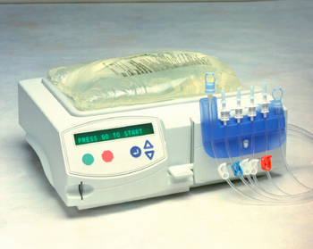

<ul style="list-style-type:circle; font-weight:bold; text-align:left;">
      <li><a href="#BPD">Bendra informacija apie PD</a></li>
      <li><a href="#RPD">Informacija apie rankinę PD</a></li>
      <li><a href="#APD">Informacija apie automatinę PD (APD)</a></li></ul>

<h2 id="BPD">Bendra informacija apie PD</h2>
<ul style="list-style-type:circle; font-weight:bold; text-align:left;">
<li><a href="#1">Kaip veikia PD?</a></li>
<li><a href="#2">Kiek trunka PD?</a></li>
</ul>

Kaip veikia PD? Peritoninės dializės metu toksinių medžiagų ir skysčių pertekliaus pašalinimas iš organizmo vyksta per pilvaplėvę, kai pilvaplėvės ertmėje yra tam tikras kiekis tirpalo, o kitą membranos pusę skalauja kapiliarinė kraujotaka. Peritoninės dializės metu toksinės medžiagos ir vanduo šalinami iš organizmo veikiant keliems skirtingiems fizikiniams procesams. Visų pirma, vyksta medžiagų difuzija per natūralius organizmo barjerus. Skystyje ištirpusios medžiagos juda tarp pilvaplėvės ertmės ir dializato pagal koncentracijos gradientą. Tokiu būdu pernešamas šlapalas, kreati¬ninas, toksinai, albuminas bei įvairūs jonai. Difuzija aktyviausiai vyksta per pirmas 4 valandas po dializato įvedimo į pilvaplėvės ertmę. Praėjus šiam laikui, net 90 % šlapalo ir 60 % kreatinino yra perėję į ultrafiltratą. Difuzijos proceso aktyvumą ir greitį lemia keli kriterijai: molekulių dydis, pilvaplėvės paviršiaus plotas ir vidinis membranos atsparumas. Antras dializės metu vykstantis procesas yra konvekcija. Jos metu veikiant hidrostatiniam ir osmosiniam slėgiui iš organizmo pašalinamas perteklinis vandens kiekis. Trečias procesas taip pat užtikrina vandens pernašą. Tai osmozė, difuzijai priešingas procesas, kadangi vanduo juda priešingai įvairių skystyje ištirpusių medžiagų sudarytam koncentracijos gradientui. Be osmozės vandens pernaša yra veikiama ir kitų faktorių. Pilvaplėvės membranos hidraulinė kondukcija, osmosinio reagento tipas ir jo refleksijos koeficientas, osmosinis gradientas, efektyvus pilvaplėvės paviršius, hidrostatinis slėgis ir dializės trukmė veikia vandens judėjimą. Dar vienas svarbus procesas, neatsiejamas nuo PD, yra vadinamas sijojimu (siewing). Kiekviena skystyje ištirpusi medžiaga turi sijojimo koeficientą, kuris priklauso nuo medžiagos masės ir krūvio. Medžiagos, turinčios aukštą sijojimo koeficientą, yra lengviau pernešamos per membraną. Sijojimas veikia osmosinį gradientą, todėl veikia ir dializės bei įvarių medžiagų pašalinimo efektyvumą. Sijojimas ypač svarbus efektyviam natrio pašalinimui.

Kiek trunka PD? Peritoninę dializę galima rinktis rankinę arba automatinę. Rankinė PD daroma keturis kartus per dieną. Kiekvienas rankinis tirpalo keitimas užtrunka 20-30 minučių. Keturis kartus per dieną reikia: prisijungti, išpilti seną tirpalą ir įsipilti naują. Automatinė peritoninė dializė trunka 8-9 valandas. Paprastai ji atliekama nakties metu. Pacientai, kurie pasirenka automatinę peritoninę dializę yra apmokomi pasidaryti ir rankinę PD. Rankinę ir automatinę PD galima keisti tarpusavyje.

<h2 id="RPD">Rankinė PD</h2>

Rankinė peritoninė dializė paprastai atliekama keturis kartus per dieną. Kaip ji atliekama galima pamatyti įkeltame video:
 
<figure class="wp-block-embed-youtube wp-block-embed is-type-video is-provider-youtube wp-embed-aspect-16-9 wp-has-aspect-ratio">

<iframe loading="lazy" title="Rankinės PD mokymai ir eiga" width="640" height="360" src="https://www.youtube.com/embed/iVXYscbZshU?feature=oembed" frameborder="0" allow="accelerometer; autoplay; clipboard-write; encrypted-media; gyroscope; picture-in-picture; web-share" referrerpolicy="strict-origin-when-cross-origin" allowfullscreen></iframe>

</figure>

Pasirinkus rankinę peritoninę dializę Jums bus įstatytas PD kateteris (daugiau informacijos apie PD kateterio įstatymą galite rasti DUK skiltyje). Kateterio vietai sugijus, maždaug po 3-4 savaičių, galėsite pradėti mokytis kaip atlikti rankinę peritoninę dializę. Peritoninės dializės centras, kuriame mokysitės, Jums suteiks tirpalo šildytuvą, išmokys atlikti peritoninę dializę, nurodys kaip užsisakyti tirpalus ir atsakys į visus Jums kilsiančius klausymus. Būkite ramūs, PD centras Jūsų nepaleis kol neįsitikins, kad viską mokate puikiai ir saugiai galėsite atlikti peritonines dializes. Tirpalai, šildytuvas, kamšteliai, dezinfekcinis skystis Jums nekainuos (visa tai apmoka ligonių kasos). Tirpalus reikės užsisakyti pačiam skambinant nurodytu telefonu (PD centras Jums papasakos ir parodys kaip viskas daroma).  Išlaidos, kurios papildomai atsiras: pleistrai kateterio perrišimams, antiseptinis skystis kateterio priežiūrai (buteliuko užtenka labai ilgam, o kaina nėra didelė), vienkartinės veido kaukės (reikalingos prisijungimo prie tirpalų metu). Kad būtų patogiau, galima nusipirkti specialų lašinių stovą, tačiau galima apseiti ir be jo. Išeitys: tirpalo maišą galima pakabinti ant pakabos ir tada pakabinti kur nors aukščiau, galima kabinti ant rubų kabyklės ir panašiai.   

<h2 id="APD">Automatinė PD</h2>
<ul style="list-style-type:circle; font-weight:bold; text-align:left;">
<li><a href="#APD1">Kaip atliekama APD?</a></li>
<li><a href="#APD2">Kada/Kaip galima pradėti atlikti APD?</a></li>
</ul>

Automatinė peritoninė dializė atliekama tokiu pat principu kaip rankinė, tik ji atliekama kiekvieną naktį naudojant specialų peritoninės dializės aparatą.  APD principas: pacientas paruošia aparatą ir jungia savo PD kateterį prie jo. Aparatas keičia tirpalus (nudrenuoja ir pripildo naujo tirpalo) visos nakties metu. Tuo metu pacientas miega, o pasibaigus dializei, kai atsibunda, tiesiog atsijungia nuo peritoninės dializės aparato. APD trunka 8-9 valandas.
 

Kada galima pradėti atlikti automatines PD? Po kateterio įstatymo praėjus 3-4 savaitėms (sugijus kateterio vietai) pradedmi PD mokymai. Pradžioje vyksta rankinės PD mokymai, o išmokus pasidaryti rankinę PD pradedama mokyti kaip atlikti automatinę peritoninę dializę. Peritoninės dializės centras Jums suteiks: mokymus, automatinės peritoninės dializės apratą, papasakos ir parodys kaip užsisakyti tirpalus. Automatinės peritoninės dializės aparatas,tipralai, kamšteliai, dizinfekcinis skystis Jums nekainuos. Visa tai apmoka ligonių kasos. Išlaidos, kurias galite patirti: pleistrai kateterio priežiūrai, antiseptinis skystis kateterio priežiūrai (kainuoja nedaug, o užtenka ilgam), vienkartinės veido kaukės (reikalingos jungiantis prie aprato). Jeigu neturite staliuko ar spintelės šalia lovos, tai gali reikėti tokią įsigyti. (Aš pirkausi IKEA pačius pigiausius du staliukus.)    

